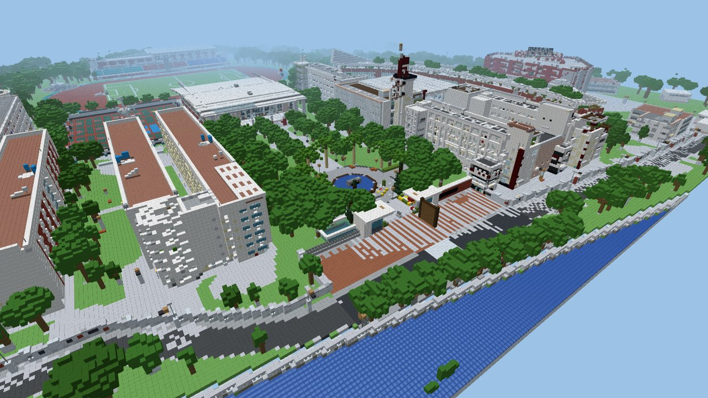
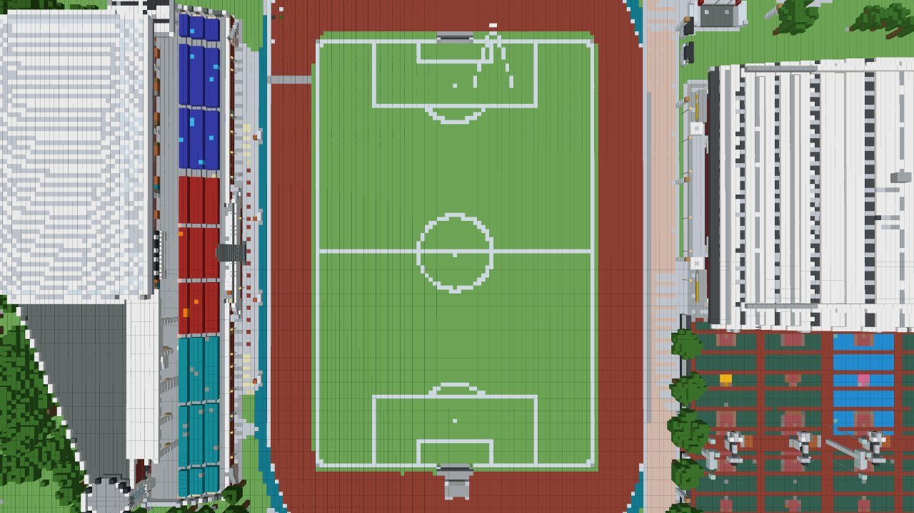

# 广东实验中学（荔湾校区）Minecraft 地图

把 3D 校园做成 Minecraft Java 版的存档（游戏版本 26.3）。比例 1:1：一格 = 1 米，方块坐标的 x、z 就是 3D 版的 x（向东）、
z（向南），高度 h 米对应 y = floor(h) + 64（地面顶在 y 64）。范围是校园和紧挨着的周边建筑，x -115 至 300、z -290 至 250。

每一版的存档在 `minecraft/releases/gdsy-minecraft-vN.zip`：解压后把 `gdsy-campus` 文件夹放进 `.minecraft/saves`，
压缩包里的“说明.txt”有传送点。

## 现在这一版（v15）有什么

- **全校**：校园和紧挨着的周边建筑（约 415 × 540 米），所有楼的外观和 3D 版里有的室内，地面、树、河涌、水池。
- **能走**：门洞按 3D 版的碰撞打开（约 300 扇木门能开关），楼梯按 3D 版每一级台阶的高度重建；钟楼和圆顶楼里是梯子。
  走路检查的 19 个地点全部能从出生点走到（教室、图书馆、体育馆、宿舍、楼梯塔顶、钟楼顶、圆顶楼露台……）。
- **室内**：课桌椅、宿舍 450 多张能睡的床、看台和体育馆的彩色座位、书架、黑板、窗帘；顶棚下有看不见的光源，晚上也亮。
- **字**：校门“广东实验中学”、校名墙、新综合楼屋顶红字、体育馆标语、“面向世界”等 14 处；教学楼 129 扇门上有门牌；出生点旁边有欢迎牌和传送指令。
- **灯**：3D 版里每一盏灯都搬了过来：路边和花园里 133 根灯杆（铁栏杆灯杆加灯笼）、球场和马路的 18 盏高杆灯（海晶灯）、
  走廊和雨棚下 211 盏吊灯（灯笼）；晚上真的会亮。
- **细节**：足球场和篮球场的线、立面上的窗格、统一的配色。
- **怎么装**：下载 `releases/` 里编号最大的压缩包，解压后把 `gdsy-campus` 放进 `.minecraft/saves`，用 Java 版 26.3 或更新的版本打开。

**还不够好的地方**：1 米的格子放不下 0.1 米的线脚、窗框和细栏杆（栏杆用铁栏杆），斜墙和弧线是阶梯状的；
部分家具（约一半的椅子）因为和课桌挤在同一格里没有放；楼上个别半砖楼面上的家具仍悬空半格；没有在游戏里实际走过（这里没有游戏），
画面只用自己画的方块预览检查过。

## 预览

下面是用 `preview.mjs` 画的方块预览（纯色方块，没有游戏的贴图和光照；不是游戏截图）。

八个传送点的视角：网架广场、钟楼顶、体育馆内、二层教室、楼梯塔敞廊、图书馆、圆顶楼、宿舍区。

## 版本计划（To do）

做完一项就打勾；每完成一个版本就出一版存档、提交到这里。

- [x] **v1 全校第一版**：整个校园从 3D 版自动转换（建筑、室内、地面、树、水）；用官方 26.3 服务器生成存档、加载检查。
- [x] **v2 走得进去、家具**
  - [x] 门洞：1 米的格子把很多门堵上了。用 3D 版自己的碰撞判断哪里是门（人能从墙的一边走到另一边、两边是真墙），把门洞打开。
  - [x] 室内半砖地面改成整块（不然家具悬空半格）。
  - [x] 家具：课桌（上半砖）、椅子（楼梯块，背对课桌）、看台和体育馆座位（彩色地毯）、宿舍的床（480 张，真能睡）、体育馆吊灯（海晶灯）。
  - [x] 走路检查：从出生点能走到的地点 11/19（体育馆内、网架广场、宿舍开水房等）。
- [x] **v3 上楼、门、室内灯**
  - [x] 楼梯：1 米的格子里 3D 版的楼梯变成了乱块。在 3D 版里每一列往下找出所有能站人的高度（每级台阶、平台、楼板，
        约 31 万处），按这些高度用半砖和整块重建台阶（每级半格，不用跳），清出头顶两格（楼梯和平台上墙头挡路的也清掉，
        楼板上的墙不动）。重建了约 4.3 万处。
  - [x] 门：1 格宽的门洞装单扇木门，2 格宽装双开门（304 扇），能开关。
  - [x] 室内灯：顶棚下每 6 格放一个看不见的光源方块（1643 个），室内白天晚上都亮。
  - [x] 足球场：草皮压过下面垫的底面，跑道和球场不再是红青杂点。按“变成同一种方块”的材质合并计票。
  - [x] 走路检查 14/19：新增二层教室、图书馆大厅、宿舍洗衣房。
  - [ ] 还到不了：钟楼顶、东侧教学楼二层外廊、两座楼梯塔顶的敞廊、圆顶楼露台（留到后面）。
- [x] **v4 字和标识**
  - [x] 3D 版上的 14 处字，用游戏的“文字展示”（text_display）放在墙面前，按 3D 版的位置、朝向和字高（1 米一格拼不出能认的 2 米高汉字）：
        校门红墙“广东实验中学”和下面的英文、校训石“爱国 团结 求实 创新”、标志楼校名墙、新综合楼屋顶红字、体育馆西立面
        “今天我以省实为荣 明天省实以我为荣”、西侧教学楼“实验楼”、宿舍檐板“面向现代化 面向世界 面向未来”、宿舍各栋门口、
        “求实楼”、“天文台”、“主席台”。字体是游戏自带的，不是 3D 版的毛笔字。
  - [x] 门牌（v14）。
  - [ ] 楼层牌、标语牌。
- [x] **v5 楼梯补完**
  - [x] 楼梯上的高度略向下取整，每一跑都是均匀的半格台阶；楼梯上清出三格头顶空间（偶尔一步一格也能跳上去）。
  - [x] 楼梯通到的楼面不再抬高半格（不然最后一级差一格半）；楼梯口（两格内有 0.3-1.2 米高差的地方）挡路的墙头可以清掉。
  - [x] 走路检查改成按真实高度差：半格直接走上去，一格要跳、要头顶有空间。
  - [x] 走路检查 17/19：东侧两座楼梯塔一直爬到顶上的敞廊。
  - [x] 钟楼顶、圆顶楼露台：见 v7。
- [x] **v6 场地线**
  - [x] 画在地上的线（足球场、马路标线、体育馆主场）在 1 米的格子里只占几个百分点，原来全被淘汰。单独处理：线经过的地面块换成线的颜色；
        马路标线要盖住一格的四分之一才画（不然整条马路变白）；跑道的分道线太密，不画；体育馆只画主场的白线和禁区。
        足球场的边线、中圈、禁区、球门区都出来了。室外篮球场的线画在贴图里，还没有。
- [x] **v7 钟楼和圆顶楼登顶**
  - [x] 钟楼：竖井东墙内侧一道梯子到 22.5 米，平台、南墙开门，接塔外两跑一格宽的楼梯（补了两个转角）到 32.1 米的挑台。
  - [x] 圆顶楼：西侧直墙内一道梯子，从一楼穿过四楼到观测室那一层，再到露台。
  - [x] 这类个别地方的手工改动写在 `fixes.json`（每处写明为什么），每次生成时最后执行。
  - [x] 走路检查 19/19。
- [x] **v8 室内方块**
  - [x] 书和书脊 → 书架方块（书脊面积在一格里过 0.08 就换，图书馆、书柜共 587 个）；黑板 → 暗海晶石（深绿）；储物柜 → 铁块；
        窗帘、主席台红桌布、体育馆垫子、旗子 → 按颜色的羊毛。
- [x] **v9 出生点欢迎牌**
  - [x] 出生点右手边一块文字展示：地图名、比例和 10 个常用传送点（每个点的高度按方块数据核对过，传过去站在地面上）；
        压缩包里的说明同步更新成 18 个传送点。
- [x] **v10 统一用色**
  - [x] 墙面只从一套精选的方块里挑（白、浅灰、深灰、黑、米、陶瓦、砖、各色混凝土），去掉颜色几乎一样的方解石、闪长岩、石英砖、凝灰岩等，
        同一面墙不再花；颜色距离改用 redmean（兼顾色相，灰色不会变成偏粉的陶瓦）；铺地只用石材和砖。
- [x] **v11 修正**
  - [x] 球场线：v6 之后加的“马路标线要盖住四分之一格”把球场白线也算了进去（两者都换成白色混凝土，被合成一类），v6-v10 的存档里球场线其实没有；
        马路标线单独成一类，球场线回来了（719 块）。
  - [x] 林荫道等处铺地上一格一格的草：地皮下叠了几层（泥土、草坪、细草坪）加起来压过了铺地；每种方块在一格里最多按一层算。
  - [x] 树冠是空心的壳：同一列上下两片树叶之间 6 格以内的空隙填上树叶（6619 块）。
  - [x] 课桌：换了颜色距离以后被配成粉色的樱花木，樱花木去掉，回到白桦木。
  - [x] 出生点朝向：面向西（校门）。
- [x] **v12 贴图细节、水**
  - [x] 原来每种材质只取贴图的平均色。现在每个采样点按贴图坐标读贴图上的颜色，每格取平均，有贴图的材质按每格自己的颜色选方块：
        室外篮球场的线、周边楼和教学楼立面上画的窗格、钟楼顶的图案都出来了（1 米一格会把砖缝这种细纹抹平，大一点的图案留下）。
  - [x] 河涌和水池的水：v5 起重建楼梯时把水底当成能站人的地方，清头顶空间时把水清掉了（v5-v11 只剩约 400 格水）；水底不重建、水从不清除，回到 6755 格。
  - [x] 色板加了暗海晶石和海晶石砖（青绿色的球场不再变灰）。
  - [x] 每版清点：球场线、书架、床、门、隐形灯、梯子、地毯、树叶、水、玻璃、灯，少于下限就报警（`metrics.py`，`release.sh` 里跑）。
- [x] **v13 家具落地**
  - [x] 一楼地面（3D 版比室外高 0.3 米）在方块里是半砖，家具只能放在上面一格，悬空半格；v5 起接楼梯的楼层又不再抬高，
        所以很多一楼的课桌椅和床是悬着的。现在一楼的半砖地面降到和室外同高（下面本来就是实心的地基），家具直接落在地上，
        门口和室外齐平，楼梯第一级还是半格。约 6400 格。楼上的半砖楼面仍按原来的办法（不占下层的层高）。
- [x] **v14 门牌**
  - [x] 北教学楼、南教学楼、实验楼、求实楼里挂了门的房间，门上方两面各一块小门牌（楼名和房间号：楼层加沿走廊的顺序，
        如“北教学楼 301”；编号是想象的，和 3D 版一样），129 扇门、258 块。
- [x] **v15 灯**
  - [x] 3D 版的灯（`src/street.js` 的 LIT：每盏路灯、花园灯、雨棚灯、走廊灯和房间灯的位置、高度和照亮范围，`lamps.mjs` 读出 895 盏）。
        灯杆 0.14 米、灯头 0.3 米，1 米的格子里原来一盏都没有：
    - 头顶两格内有顶棚的：顶棚下挂一盏灯笼，贴着顶棚；顶棚是上半砖的，那一格改成整块当灯座（楼上的地面不变）；
      灯下要留两格给人走（课桌、椅子不算），本格放不下就放旁边一格。211 盏。
    - 露天的：从地面（穿过树冠）立一根铁栏杆灯杆到灯的高度，上面一盏灯笼，133 根；照亮范围 10 米以上的高杆灯（球场、马路）顶上是海晶灯，18 盏。
    - 没放的：已经有发光方块的（大灯具体素化时留下了）129 盏，很小的灯 10 盏，地图外 68 盏，
      放不下的 326 盏（多是只有两格高的房间：挂灯会碰头，那里只有原来看不见的光源）。
  - [ ] 窗框和窗台：1 米的格子里放不下 0.06 米的窗框，挪到 v18 再看（可能用活板门或楼梯块做窗台）。
- [ ] **v16 室外**
  - [ ] 树：真正的树干和树冠形状（各种树：大叶榕、棕榈、松柏）。
  - [ ] 跑道分道线、足球场线、篮球场线；草坪、花坛。
  - [ ] 路灯（栅栏 + 灯笼）、长椅（楼梯块）、垃圾桶、旗杆和国旗、自行车棚。
  - [ ] 河涌、水池的岸和栏杆。
- [ ] **v17 室内精修**
  - [ ] 教室：黑板、讲台、风扇、窗帘、后墙黑板报。
  - [ ] 图书馆：书架方块、阅览桌、借还台。
  - [ ] 宿舍：上下铺、书桌、柜子、阳台。
  - [ ] 体育馆：篮球架、记分牌、看台。
  - [ ] 实验室、办公室、卫生间、门厅（荣誉墙）。
- [ ] **v18 打磨**
  - [ ] 屋顶：女儿墙、设备、太阳能板。
  - [ ] 窗框和窗台（从 v15 挪过来）。
  - [ ] 周边建筑和街道。
  - [x] 出生点导览牌（v9）。
  - [ ] 全校地图（地图画）。

## 版本记录

| 版本 | 内容 | 走路检查（能走到的地点） |
|---|---|---|
| v1 | 全校自动转换，官方 26.3 服务器生成 | 9/19 |
| v2 | 门洞打开（425 处）、室内地面整块、家具（床 480、座位 613、课桌 1474、椅子 337、吊灯 52） | 11/19 |
| v3 | 楼梯按 3D 版站人高度重建（4.3 万处）、木门 304 扇、室内隐形灯 1643 个、足球场和跑道修正 | 14/19 |
| v4 | 14 处字（文字展示，按 3D 版位置和字高） | 14/19 |
| v5 | 楼梯补完：均匀半格台阶、三格头顶空间、楼梯口清障；走路检查按真实高度差（这一版起河涌的水被误清，v12 修好） | 17/19 |
| v6 | 场地线：足球场、马路、体育馆主场（球场线在 v6-v10 的存档里其实丢了，v11 修好） | 17/19 |
| v7 | 钟楼和圆顶楼登顶（梯子和楼梯补块，`fixes.json`） | 19/19 |
| v8 | 室内方块：书架 587、黑板、储物柜、布料 | 19/19 |
| v9 | 出生点欢迎牌和传送点 | 19/19 |
| v10 | 统一用色（精选色板、redmean 颜色距离、铺地单独色板） | 19/19 |
| v11 | 修正：球场线回来、铺地不再出草格、树冠实心、课桌颜色、出生朝向 | 19/19 |
| v12 | 贴图细节（按每格颜色选方块）、水回来、青绿色球场、每版清点 | 19/19 |
| v13 | 一楼地面降到室外同高，家具和床落地 | 19/19 |
| v14 | 门牌（四栋教学楼 129 扇门） | 19/19 |
| v15 | 灯：灯杆 133 根、高杆灯 18 盏、吊灯 211 盏（按 3D 版每盏灯的位置和高度） | 19/19 |

## 流程（怎么做出来的）

1. `node minecraft/voxelize.mjs <本地网址> <vox.json> x0 x1 z0 z1 y0 y1 --tile 128`
   在无头浏览器里加载 3D 校园（`?lightdebug=1` 会把场景交给脚本），把盒子范围内每个可见网格的三角面撒点采样，
   每个点沿面的法线往里推 0.1 米，落到 1 米的格子里；每格记下每种材质的面积、平均高度和命中了八个 0.5 米小格中的哪几个。
   走动的人、车、鸟，纯碰撞用的隐形网格不算；只在近处显示的细节（室内、各层房间）先全部打开，每块之前都重新打开
   （页面每帧会把它们藏回去）。有名字的家具（课桌、椅子、座位、床垫、吊灯）不采样，交给第 2 步换成游戏里的做法。
2. `python minecraft/build_world.py <vox_*.json> --out <存档> --open open.json --blocks blocks.npz`
   每格取面积最大的材质（顶面稍占优，铺地压过下面的地皮），按 `blocks.py` 换成方块：按材质名分类（玻璃、树叶、水、金属、
   木、灯、花……），类内取平均颜色最接近的方块；再按小格判断形状：下半 → 下半砖，上半 → 上半砖，下半满、上半一侧 → 楼梯，
   薄玻璃 → 玻璃板，细金属 → 铁栏杆；地面及以下一律整块。水灌到底，树叶不腐烂，玻璃板和铁栏杆算好连接。
   然后打开门洞、把室内半砖地面改成整块、摆家具，写出区块文件。
3. 门洞（`doorways.py`、`carve.mjs`）：找出“两边能站人、中间一到两格墙”的位置，用 3D 版自己的碰撞让一个人从墙的一边
   走到另一边；走得过去、而且两边各 4 格以内有 3D 里的真墙、宽度不超过 4 格的，就打开（两格高）。
4. `python minecraft/server_pack.py <服务器文件夹> <存档> <输出> --box=-115,300,-290,250`
   用 Mojang 官方服务器（用户同意了 EULA）新建超平坦世界（地面和地图对齐），放进区块文件，强制加载每个区块让游戏
   自己升级格式、计算光照，设出生点、中午、晴天、和平、创造，保存。26.1 起存档结构变了，这样做出来的存档一定是游戏认的格式。
5. 灯（`lamps.mjs`）：3D 版每盏灯的位置、高度和照亮范围，`build_world.py --lamps` 换成灯笼和灯杆。
6. 字（`lettering.json`、`lettering.py`）：3D 版上每处字的盒子和朝向，换成服务器的 summon 指令，在第 4 步里执行。
7. 检查：`check_world.py`（按游戏的读法读回来）、`walk_check.py`（在方块里模拟走路，`targets.json` 是要能走到的地点）、
   预览图 `export_preview.py` + `preview.mjs`（纯色方块，不进游戏看个大概）。
8. 一键出版本：`sh minecraft/release.sh vN <工作目录> <服务器目录> <本地网址>`。

需要：Node 和 Playwright（同网站的测试），Python 3.9+、numpy、nbtlib，Java 25（官方服务器）。

## 想象和取舍

- 方块的选择全是判断，不是量测：比如白色面砖用平滑石英，红墙用红色陶瓦，深色玻璃用灰色染色玻璃。
- 1 米的格子放不下细部：斜墙和弧线是阶梯状，0.1 米的线脚、窗框消失，细栏杆和灯杆用铁栏杆。
- 家具是游戏里的惯用做法（楼梯块当椅子、上半砖当桌面、地毯当座位），不是 3D 版的形状；书包、书本、被褥的褶等小件不放。
- 3D 版里会动的东西（人、车、鸟、电梯）和自己的光照、贴图都没有带过来。
