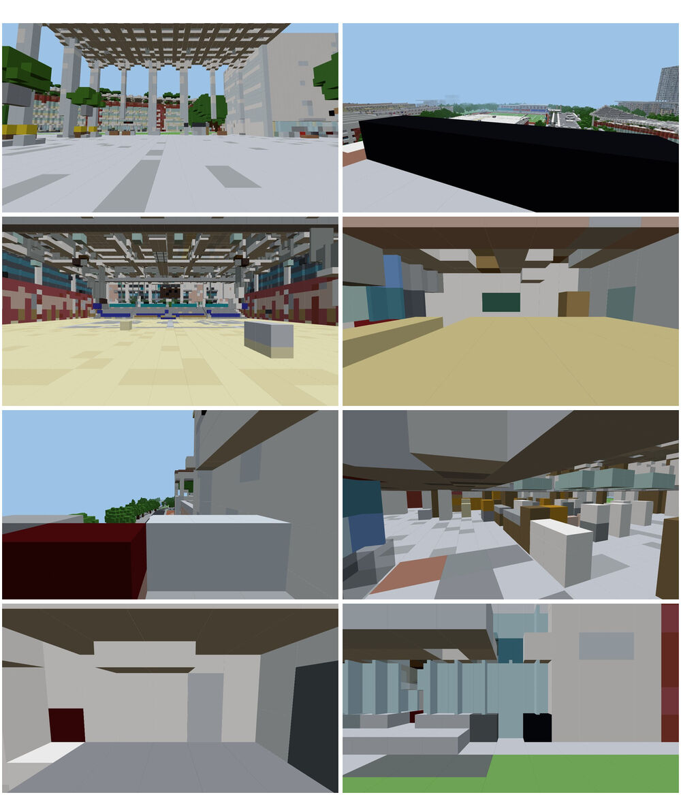
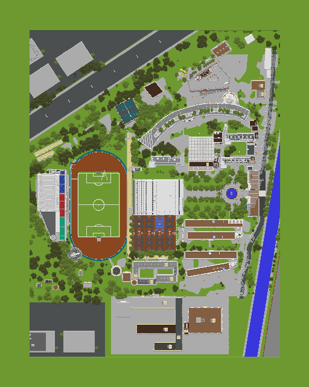
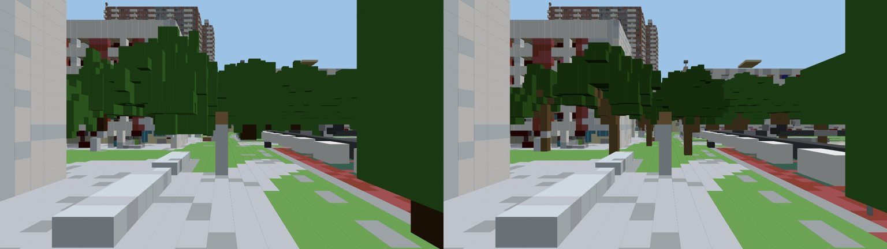

# 广东实验中学（荔湾校区）Minecraft 地图

把 3D 校园做成 Minecraft Java 版的存档（游戏版本 26.3）。比例 1:1：一格 = 1 米，方块坐标的 x、z 就是 3D 版的 x（向东）、
z（向南），高度 h 米对应 y = floor(h) + 64（地面顶在 y 64）。范围是校园和紧挨着的周边建筑，x -115 至 300、z -290 至 250。

每一版的存档在 `minecraft/releases/gdsy-minecraft-vN.zip`：解压后把 `gdsy-campus` 文件夹放进 `.minecraft/saves`，
压缩包里的“说明.txt”有传送点。

## 现在这一版（v29）有什么

- **全校**：校园和紧挨着的周边建筑（约 415 × 540 米），所有楼的外观和 3D 版里有的室内，地面、树、河涌、水池。
- **能走**：门洞按 3D 版的碰撞打开（约 300 扇木门能开关），楼梯按 3D 版每一级台阶的高度重建；钟楼、圆顶楼和新综合楼（四楼以上）里是梯子；
  走不到的楼层部分另开了 15 个门洞。
  走路检查的 21 个地点全部能从出生点走到（教室、图书馆、体育馆、宿舍、楼梯塔顶、钟楼顶、圆顶楼露台、新综合楼顶层……）。
- **室内**：教室里一排课桌一排椅子（51 间）、宿舍 478 张能睡的床（上下铺）、看台和体育馆的彩色座位、书架、黑板、窗帘；顶棚下有看不见的光源，晚上也亮。
- **字**：校门“广东实验中学”、校名墙、新综合楼屋顶红字、体育馆标语、“面向世界”等 14 处；出生点旁边有欢迎牌和传送指令。
  教室里黑板上写着当天的课（《劝学》、二次函数、牛顿第二定律、Unit 3……，和 3D 版一样），后墙有黑板报标题和标语；
  门边是 3D 版的班牌（“101 实验楼 / 高一（1）班”），楼梯口有楼层牌，走廊有“安全出口”，黑板上方有国旗和一只真的钟（游戏里的时间），
  墙上有课程表、值日表、奖状、海报、“爱国 团结 / 求实 创新”……共 856 块（求实楼 3D 版没有门牌，还是 v14 编的门牌）。
  每间教室黑板前有讲台（讲台块），上面一本书，右键翻开就是黑板上那节课。
  其他楼的字也搬了过来，约 1300 块：宿舍的房号牌和“宿舍管理规定”“开水间”“盥洗室”“高考倒计时 100 天”，求实楼的“教务处”“教工会议室”，
  图书馆的海报和屏幕，圆顶楼的“太阳系”“月相”，看台下的“男卫生间”“器材室”，消火栓、楼层号……
- **树**：3D 版的 867 棵树按各自的形状重新种成游戏里的树：树干（粗的两格见方）、六根树枝、十一团树冠，边缘参差；
  大王椰子是浅色树干、绿色冠茎和八片下垂的叶子；松柏一层层收尖。树下留两格高，人能从树下走。
- **全校地图**：出生点西边的公告栏上挂着 4×5 张游戏里的地图，拼成整个校园的俯视图（一格一个像素，北在上）。
- **灯**：3D 版里每一盏灯都搬了过来：路边和花园里 133 根灯杆（铁栏杆灯杆加灯笼）、球场和马路的 18 盏高杆灯（海晶灯）、
  走廊和雨棚下 212 盏吊灯（灯笼），矮房间顶棚里嵌 85 盏海晶灯；晚上真的会亮。
- **细节**：足球场和篮球场的线、体育馆和篮球场的 22 个篮球架、立面上的窗格、统一的配色；升旗台上的国旗（红底、一角黄星）、校旗；河涌边的石栏杆。
- **传送菜单**：第一次进存档，聊天栏里出现欢迎和 20 个地点，点地名就传送，还有“看夜景”“回到中午”（`/function gdsy:menu` 再打开）；存档允许作弊，`/tp` 能用。
- **怎么装**：下载 `releases/` 里编号最大的压缩包，解压后把 `gdsy-campus` 放进 `.minecraft/saves`，用 Java 版 26.3 或更新的版本打开。

**还不够好的地方**：1 米的格子放不下 0.1 米的线脚、窗框和细栏杆（栏杆用铁栏杆），斜墙和弧线是阶梯状的；
两格高、顶棚是半砖的房间（约 240 盏灯的位置）没有看得见的灯；教室以外的房间里，挤在同一格的课桌椅只放了一件；
楼上个别半砖楼面上的家具仍悬空半格；没有在游戏里实际走过（这里没有游戏），画面只用自己画的方块预览检查过；
全校地图的地图文件、传送菜单的数据包按 26.3 服务器的代码和加载结果核对过，但没有进游戏看过。

## 预览

下面是用 `preview.mjs` 画的方块预览（纯色方块，没有游戏的贴图和光照；不是游戏截图；v21 的方块，文字展示、物品展示框这些实体不画）。

八个传送点的视角：网架广场、钟楼顶、体育馆内、二层教室、楼梯塔敞廊、图书馆、圆顶楼、宿舍区。

v20 的全校地图（公告栏上 20 张游戏地图拼成的图，一格一个像素，用游戏的地图配色）：

v16 的树：左边是 v15（体素化的树冠，一整块实心绿方块），右边是 v16（按 3D 版每棵树的树干、树枝和叶团重种）。

## 版本计划（To do）

做完一项就打勾；每完成一个版本就出一版存档、提交到这里。

- [x] **v1 全校第一版**：整个校园从 3D 版自动转换（建筑、室内、地面、树、水）；用官方 26.3 服务器生成存档、加载检查。
- [x] **v2 走得进去、家具**
  - [x] 门洞：1 米的格子把很多门堵上了。用 3D 版自己的碰撞判断哪里是门（人能从墙的一边走到另一边、两边是真墙），把门洞打开。
  - [x] 室内半砖地面改成整块（不然家具悬空半格）。
  - [x] 家具：课桌（上半砖）、椅子（楼梯块，背对课桌）、看台和体育馆座位（彩色地毯）、宿舍的床（480 张，真能睡）、体育馆吊灯（海晶灯）。
  - [x] 走路检查：从出生点能走到的地点 11/19（体育馆内、网架广场、宿舍开水房等）。
- [x] **v3 上楼、门、室内灯**
  - [x] 楼梯：1 米的格子里 3D 版的楼梯变成了乱块。在 3D 版里每一列往下找出所有能站人的高度（每级台阶、平台、楼板，
        约 31 万处），按这些高度用半砖和整块重建台阶（每级半格，不用跳），清出头顶两格（楼梯和平台上墙头挡路的也清掉，
        楼板上的墙不动）。重建了约 4.3 万处。
  - [x] 门：1 格宽的门洞装单扇木门，2 格宽装双开门（304 扇），能开关。
  - [x] 室内灯：顶棚下每 6 格放一个看不见的光源方块（1643 个），室内白天晚上都亮。
  - [x] 足球场：草皮压过下面垫的底面，跑道和球场不再是红青杂点。按“变成同一种方块”的材质合并计票。
  - [x] 走路检查 14/19：新增二层教室、图书馆大厅、宿舍洗衣房。
  - [ ] 还到不了：钟楼顶、东侧教学楼二层外廊、两座楼梯塔顶的敞廊、圆顶楼露台（留到后面）。
- [x] **v4 字和标识**
  - [x] 3D 版上的 14 处字，用游戏的“文字展示”（text_display）放在墙面前，按 3D 版的位置、朝向和字高（1 米一格拼不出能认的 2 米高汉字）：
        校门红墙“广东实验中学”和下面的英文、校训石“爱国 团结 求实 创新”、标志楼校名墙、新综合楼屋顶红字、体育馆西立面
        “今天我以省实为荣 明天省实以我为荣”、西侧教学楼“实验楼”、宿舍檐板“面向现代化 面向世界 面向未来”、宿舍各栋门口、
        “求实楼”、“天文台”、“主席台”。字体是游戏自带的，不是 3D 版的毛笔字。
  - [x] 门牌（v14；v19 起北、南教学楼和实验楼换成 3D 版的班牌）。
  - [x] 楼层牌、标语牌（v17、v19，用 3D 版自己的字）。
- [x] **v5 楼梯补完**
  - [x] 楼梯上的高度略向下取整，每一跑都是均匀的半格台阶；楼梯上清出三格头顶空间（偶尔一步一格也能跳上去）。
  - [x] 楼梯通到的楼面不再抬高半格（不然最后一级差一格半）；楼梯口（两格内有 0.3-1.2 米高差的地方）挡路的墙头可以清掉。
  - [x] 走路检查改成按真实高度差：半格直接走上去，一格要跳、要头顶有空间。
  - [x] 走路检查 17/19：东侧两座楼梯塔一直爬到顶上的敞廊。
  - [x] 钟楼顶、圆顶楼露台：见 v7。
- [x] **v6 场地线**
  - [x] 画在地上的线（足球场、马路标线、体育馆主场）在 1 米的格子里只占几个百分点，原来全被淘汰。单独处理：线经过的地面块换成线的颜色；
        马路标线要盖住一格的四分之一才画（不然整条马路变白）；跑道的分道线太密，不画；体育馆只画主场的白线和禁区。
        足球场的边线、中圈、禁区、球门区都出来了。室外篮球场的线画在贴图里，还没有。
- [x] **v7 钟楼和圆顶楼登顶**
  - [x] 钟楼：竖井东墙内侧一道梯子到 22.5 米，平台、南墙开门，接塔外两跑一格宽的楼梯（补了两个转角）到 32.1 米的挑台。
  - [x] 圆顶楼：西侧直墙内一道梯子，从一楼穿过四楼到观测室那一层，再到露台。
  - [x] 这类个别地方的手工改动写在 `fixes.json`（每处写明为什么），每次生成时最后执行。
  - [x] 走路检查 19/19。
- [x] **v8 室内方块**
  - [x] 书和书脊 → 书架方块（书脊面积在一格里过 0.08 就换，图书馆、书柜共 587 个）；黑板 → 暗海晶石（深绿）；储物柜 → 铁块；
        窗帘、主席台红桌布、体育馆垫子、旗子 → 按颜色的羊毛。
- [x] **v9 出生点欢迎牌**
  - [x] 出生点右手边一块文字展示：地图名、比例和 10 个常用传送点（每个点的高度按方块数据核对过，传过去站在地面上）；
        压缩包里的说明同步更新成 18 个传送点。
- [x] **v10 统一用色**
  - [x] 墙面只从一套精选的方块里挑（白、浅灰、深灰、黑、米、陶瓦、砖、各色混凝土），去掉颜色几乎一样的方解石、闪长岩、石英砖、凝灰岩等，
        同一面墙不再花；颜色距离改用 redmean（兼顾色相，灰色不会变成偏粉的陶瓦）；铺地只用石材和砖。
- [x] **v11 修正**
  - [x] 球场线：v6 之后加的“马路标线要盖住四分之一格”把球场白线也算了进去（两者都换成白色混凝土，被合成一类），v6-v10 的存档里球场线其实没有；
        马路标线单独成一类，球场线回来了（719 块）。
  - [x] 林荫道等处铺地上一格一格的草：地皮下叠了几层（泥土、草坪、细草坪）加起来压过了铺地；每种方块在一格里最多按一层算。
  - [x] 树冠是空心的壳：同一列上下两片树叶之间 6 格以内的空隙填上树叶（6619 块）。
  - [x] 课桌：换了颜色距离以后被配成粉色的樱花木，樱花木去掉，回到白桦木。
  - [x] 出生点朝向：面向西（校门）。
- [x] **v12 贴图细节、水**
  - [x] 原来每种材质只取贴图的平均色。现在每个采样点按贴图坐标读贴图上的颜色，每格取平均，有贴图的材质按每格自己的颜色选方块：
        室外篮球场的线、周边楼和教学楼立面上画的窗格、钟楼顶的图案都出来了（1 米一格会把砖缝这种细纹抹平，大一点的图案留下）。
  - [x] 河涌和水池的水：v5 起重建楼梯时把水底当成能站人的地方，清头顶空间时把水清掉了（v5-v11 只剩约 400 格水）；水底不重建、水从不清除，回到 6755 格。
  - [x] 色板加了暗海晶石和海晶石砖（青绿色的球场不再变灰）。
  - [x] 每版清点：球场线、书架、床、门、隐形灯、梯子、地毯、树叶、水、玻璃、灯，少于下限就报警（`metrics.py`，`release.sh` 里跑）。
- [x] **v13 家具落地**
  - [x] 一楼地面（3D 版比室外高 0.3 米）在方块里是半砖，家具只能放在上面一格，悬空半格；v5 起接楼梯的楼层又不再抬高，
        所以很多一楼的课桌椅和床是悬着的。现在一楼的半砖地面降到和室外同高（下面本来就是实心的地基），家具直接落在地上，
        门口和室外齐平，楼梯第一级还是半格。约 6400 格。楼上的半砖楼面仍按原来的办法（不占下层的层高）。
- [x] **v14 门牌**
  - [x] 北教学楼、南教学楼、实验楼、求实楼里挂了门的房间，门上方两面各一块小门牌（楼名和房间号：楼层加沿走廊的顺序，
        如“北教学楼 301”；编号是想象的，和 3D 版一样），129 扇门、258 块。
- [x] **v15 灯**
  - [x] 3D 版的灯（`src/street.js` 的 LIT：每盏路灯、花园灯、雨棚灯、走廊灯和房间灯的位置、高度和照亮范围，`lamps.mjs` 读出 895 盏）。
        灯杆 0.14 米、灯头 0.3 米，1 米的格子里原来一盏都没有：
    - 头顶两格内有顶棚的：顶棚下挂一盏灯笼，贴着顶棚；顶棚是上半砖的，那一格改成整块当灯座（楼上的地面不变）；
      灯下要留两格给人走（课桌、椅子不算），本格放不下就放旁边一格。211 盏。
    - 露天的：从地面（穿过树冠）立一根铁栏杆灯杆到灯的高度，上面一盏灯笼，133 根；照亮范围 10 米以上的高杆灯（球场、马路）顶上是海晶灯，18 盏。
    - 没放的：已经有发光方块的（大灯具体素化时留下了）129 盏，很小的灯 10 盏，地图外 68 盏，
      放不下的 326 盏（多是只有两格高的房间：挂灯会碰头，那里只有原来看不见的光源）。
  - [ ] 窗框和窗台：1 米的格子里放不下 0.06 米的窗框，挪到 v31 再看（可能用活板门或楼梯块做窗台）。
- [x] **v16 树**
  - [x] 原来树是把 3D 版的树叶卡片体素化：卡片碰到的格子都变成树叶，再把空隙填上，树冠成了一大块实心的绿方块。
        现在 `trees.mjs` 从 3D 版的几何里读回每棵树的形状（树干的底和顶、六根树枝的三段、十一个叶团的中心和大小，按每棵树的缩放），
        `build_world.py --trees` 先清掉体素化的树叶和树干（不动绿篱），再按形状种树：
    - 阔叶树 850 棵：橡木树干（3D 版里 1.3 米以上粗的用 2×2），树枝用四面树皮的橡木，叶团是一个个椭球，边上随机缺块；
      两种叶色（3D 版偏黄的那种用深色橡树叶）；
    - 大王椰子 13 棵：去皮白桦木树干、绿色陶瓦冠茎、八片丛林树叶，末端下垂（3D 版的椰树干材质名是 palmTrunk，原来被当成了石头）；
    - 松柏 4 棵：云杉树干，一层大一层小的云杉叶收到顶。
  - [x] 树冠离地至少两格（矮树一格），人从树下走；走路检查 19/19。
- [x] **v17 教室的字、墙**
  - [x] 3D 版教室里的字（每个字都是 3D 版编的）：黑板上当天的课（标题黄粉笔、内容白粉笔，21 种课：《劝学》《师说》、二次函数、
        导数与切线、牛顿第二定律、氧化还原反应、Unit 3 Travel Journal……）、后墙黑板报的标题（青春飞扬、书香校园……）、
        黑板报上方的标语（“天行健 君子以自强不息”“业精于勤 荒于嬉”……红底黄字和白底红字相间）。
        `boards.mjs` 读出每张卡片的位置、朝向、大小和是哪一课（3D 版把这些画在贴图集里，脚本给页面一个打了补丁的副本拿到贴图集的索引，
        仓库里的 3D 代码不改），`boards.py` 换成文字展示：黑板是深绿底的文字展示本身，课文一行行写上去。144 块（17 块所在的墙在方块里找不到，没放）。
  - [x] 修正：教室的隔墙、黑板墙在 v3 起有一格高的洞（离地第一格）。原因：3D 版这些墙没有碰撞体，重建楼梯时把墙脚当成能站人的台阶，
        清了“头顶空间”。现在平地上（不在楼梯口）从地面起连续三格实心的柱子算墙，不清。
        （顺带：从出生点走得到的范围少了约 7%，多是校外街道和河涌，原来是从围墙、栏杆上的洞钻过去的。）
  - [x] 立面更干净：有贴图的材质，每格的颜色要和这个材质的典型颜色（全图按面积取中位数）差得够多（约 30 级灰）才换方块；
        贴图里的轻微明暗（污渍、阴影）不再把一面墙变成好几种灰色的花墙。窗格、球场线这种反差大的照旧。约 5 万格变了。
- [x] **v18 室外：升旗台、河涌栏杆**
  - [x] 升旗台：三根旗杆在 1 米的格子里断成几截，国旗只剩一排红羊毛。照 3D 版的尺寸重做（`fixes.json`）：中间国旗杆 15 米，
        国旗 3×2 格红羊毛、旗杆一侧上角一格黄羊毛当五角星；两边 12 米的旗杆挂白色校旗和青色旗。
  - [x] 河涌的石栏杆：栏杆柱和栏杆在 1 米的格子里填满了，成了一格半高的实心矮墙。`groupcells.mjs` 读出 3D 版栏杆占的格子，
        `build_world.py --balustrades` 换成闪长岩墙（游戏会把相邻的墙连起来：沿网格是一道矮墙，斜着走是一排柱子），590 格。
  - [ ] 跑道分道线：跑道每道 1.22 米，1 米的格子画不出来（几乎每格都会是白线），不画。
  - [ ] 长椅、垃圾桶、自行车棚（3D 版里这些是合并的几何体，没有单独的位置清单，还没做）。
- [x] **v19 室内的字（二）**
  - [x] `boards.mjs` 读出 3D 版教学楼里所有带字的卡片（1048 张），`boards.py` 按 3D 版的配色换成文字展示，856 块：
    - 班牌和储物间牌：蓝底白字，门牌号、楼名、班名（“301 北教学楼 / 高二（5）班”，班名和科组名是 3D 版编的），代替 v14 编的门牌
      （北教学楼、南教学楼、实验楼；求实楼 3D 版没有门牌，保留 v14 的）；
    - 楼层牌（“3F / 北教学楼 · 三楼”）、安全出口（绿底，“安全出口 / EXIT →”）、楼梯口“上下楼梯 靠右慢行”“请勿追逐打闹”、饮水处、节约用水、疏散示意图；
    - 黑板上方的国旗（红底一颗黄星）和钟：钟是挂在物品展示框里的游戏里的钟，指针跟着游戏时间走；
    - 课程表、值日表、班级公约、奖状、流动红旗、学习园地、“爱国 团结 / 求实 创新”、走廊海报的标题（校园公告、光荣榜、科技节……）、作文标题。
  - [x] 墙后一米内没有墙的（吊在走廊顶下的安全出口、门框边伸出来的牌子）按 3D 版的位置挂在半空；1 米的格子里落进顶棚的，往下挪到空处。
  - 没放的：柜子、书脊、开关、屏幕、小画这些没有字或字太小的卡片；191 张在方块里找不到地方。
- [x] **v20 全校地图**
  - [x] 出生点西边立一块公告栏（深色橡木立柱、云杉木板面，`fixes.json`），挂 4×5 个物品展示框，每个里面一张游戏的地图（锁定的，游戏不会重画），
        拼成 512×640 格的校园俯视图：`mapart.py` 从方块里取每一列最上面露出来的方块，按游戏的地图配色（61 种底色，
        比北边高的亮一档、低的暗一档，和游戏自己画地图一样）画成地图文件，在服务器加载存档之前放进去（26.x 的地图文件在
        `data/minecraft/maps/<编号>.dat`，按服务器自带的文件迁移规则找到的）。上方一行标题。
        （没有进游戏看过：服务器没有玩家时不读地图文件，所以只核对了格式和位置，和 26.3 服务器代码里的字段名、路径一致。）
- [x] **v21 讲台、欢迎牌**
  - [x] 讲台：每块写着课的黑板前两格放一个讲台（游戏的讲台块），朝着黑板（老师站在讲台和黑板之间面向学生），
        上面一本成书，书名是课题，内容是黑板上那节课（53 个）。用服务器的 setblock 放，格式由 26.3 服务器检查。
  - [x] 出生点欢迎牌和压缩包里的说明：加上“左边公告栏：全校地图”、升旗台和河涌边两个传送点、讲台上的书和黑板上方的钟。
- [x] **v22 宿舍上下铺**
  - [x] 3D 版宿舍有 480 个床垫（每张上下铺两个，上下相隔 1.1 米），原来只放了 415 张，而且二楼以上下铺的床多半陷在楼板里
        （床垫在 3D 版楼面上 0.4 米，1 米的格子把楼面算到了上一个整米），有的放不下（上铺的床架被体素化成一排石头，正好占住下铺的位置）。
        现在床先找床垫所在那一格或上一格，两头都有东西托着、自己又不是楼板（四面都是实心的）的地方，床架变成的石头让开：
        478 张，下铺在楼面上、上铺叠在上面（游戏里上下铺常见的做法）。
- [x] **v23 楼梯转角、嵌顶灯**
  - [x] 楼梯块的转角：游戏放楼梯时会把相邻两块拼成内角或外角，但只在旁边有方块变化时才重算；直接写进存档的楼梯都是直的，
        屋檐、线脚、台阶拐弯的地方是两个方头。现在按游戏的规则（StairBlock.getStairsShape）算好：8411 块里 116 块是转角。
  - [x] 嵌顶灯：两格高的房间挂不了灯笼（会碰头），顶棚是整块、上面还有实心的地方，把那一块换成海晶灯（楼上地面不变），85 盏；
        还剩 238 盏放不下（顶棚是半砖，上面就是楼上的地面）。
- [x] **v24 教室的课桌椅**
  - [x] 3D 版教室的课桌相隔约 1.2 米，1 米的格子里几乎每格都是课桌，拼成一整张大桌面；北、南教学楼的课桌和椅子在 3D 版里是一个整体，
        所以没有椅子。现在按每块写着课的黑板（位置和朝向来自 `boards.mjs`）找出那间教室这一层黑板前的课桌，按离黑板的远近分成一排排：
        离黑板近的一排是课桌，后面一排变成椅子（橡木楼梯块，靠背朝后），这样一排桌一排椅，和游戏里常见的教室一样。
        51 间教室，719 张课桌变成椅子；实验楼自己有椅子的教室不动。
- [x] **v25 走得到更多地方**
  - [x] 新综合楼：3D 版的楼梯是弧形的一跑，1 米的格子里三楼到四楼那一段的台阶接不上，四楼以上整整四层（约 6000 格）走不上去。
        在弧形楼梯旁开一个竖井，西墙内侧一道梯子从三楼通到顶层（`fixes.json`）。走路检查加了“新综合楼四楼”“新综合楼顶层”，21/21。
  - [x] 被隔开的楼层部分：`access.py` 找出走不到的室内区域（一层里被墙隔开、门被体素封住的地方，60 格以上），
        各在一道一格厚的墙上开一个两格高的门洞，通到同一层走得到的室内，开完再找，直到不再多出来（15 个门洞）。
        这些门洞的位置是想象的：3D 版没说真门在哪，就开在最近的地方。求实楼二层原来只走得到西翼（1015 格里 227 格），现在 785 格。
        全图从出生点走得到的站立格从 42.6 万到 43.6 万。
- [x] **v26 篮球架**
  - [x] 3D 版体育馆里 6 个吊在屋顶下的篮筐、室外 8 片球场的 16 个篮筐，1 米的格子里只剩几块零散方块。`hoops.mjs` 读出每块篮板的位置和大小，
        `hoops.py` 照游戏里常见的做法放：白色玻璃板 2×2 当篮板（下面一排和篮筐一样高），篮板前一格一个漏斗当篮筐和网，
        朝向同一片球场另一头的篮板。22 个，用服务器的 setblock 放。
- [x] **v27 指令能用、传送菜单**
  - [x] 修正（v1 起就有）：存档是官方服务器生成的，`level.dat` 里 allowCommands 是 0，单人游戏里不能用指令，
        欢迎牌和说明里写的 `/tp` 全都用不了（除非开局域网时打开作弊）。现在设成 1。
  - [x] 数据包 `gdsy`（`minecraft/datapack/`，服务器加载存档前放进 `datapacks`）：每个玩家第一次进来时（进度 `gdsy:welcome`，tick 触发，只一次），
        聊天栏显示欢迎和 20 个地点，点地名运行 `/tp`，鼠标停在上面显示坐标；`/function gdsy:menu` 再打开。格式（121）和字段名按 26.3 服务器核对，
        服务器加载时检查过。
- [x] **v28 全校的字（三）、河涌补缝**
  - [x] 教学楼以外的字：3D 版各个楼的字画在不同的画布上，没有统一的清单。`signs.mjs` 在浏览器里给画布的 fillText 套一层记录
        （只在导出用的页面里，网站代码不改），记下每个字画在哪张画布的什么位置、什么颜色；然后每个用这种画布做贴图的竖直四边形就是一块牌子，
        它贴图范围里画的字就是牌子上的字，一行行按上下排。1598 块，`signs.py` 放了 1328 块（去掉和黑板卡片、大字重复的，找不到墙的）：
        宿舍房号牌、宿舍管理规定、开水间、盥洗室、高考倒计时；求实楼的科室门牌；图书馆海报和屏幕；圆顶楼的展板；看台下的卫生间、器材室；
        消火栓、楼层号、通知公告……底色取画布上牌子中间的颜色（正好落在字上时换成白底或深色底）。
  - [x] 河涌补缝：岸边在水面那一格有 85 处缺口（水旁边是空气），游戏只在旁边方块变化时才让水流动，看着没事，但玩家在附近放一块方块，
        河水就会漫上岸。缺口补上石头。
- [x] **v29 看夜景**
  - [x] 存档固定在中午，路灯、吊灯和顶棚的灯要天黑才看得出来：传送菜单加“看夜景”（/time set 18000）和“回到中午”两个按钮。
- [ ] **v30 室内精修（续）**
  - [ ] 教室：风扇、窗帘。
  - [ ] 图书馆：阅览桌、借还台。
  - [ ] 宿舍：书桌、柜子、阳台。
  - [ ] 体育馆：记分牌。
  - [ ] 实验室、办公室、卫生间。
- [ ] **v31 打磨**
  - [ ] 屋顶：女儿墙、设备、太阳能板。
  - [ ] 窗框和窗台（从 v15 挪过来）。
  - [ ] 周边建筑和街道。
  - [x] 出生点导览牌（v9）。
  - [x] 全校地图（v20）。

## 版本记录

| 版本 | 内容 | 走路检查（能走到的地点） |
|---|---|---|
| v1 | 全校自动转换，官方 26.3 服务器生成 | 9/19 |
| v2 | 门洞打开（425 处）、室内地面整块、家具（床 480、座位 613、课桌 1474、椅子 337、吊灯 52） | 11/19 |
| v3 | 楼梯按 3D 版站人高度重建（4.3 万处）、木门 304 扇、室内隐形灯 1643 个、足球场和跑道修正 | 14/19 |
| v4 | 14 处字（文字展示，按 3D 版位置和字高） | 14/19 |
| v5 | 楼梯补完：均匀半格台阶、三格头顶空间、楼梯口清障；走路检查按真实高度差（这一版起河涌的水被误清，v12 修好） | 17/19 |
| v6 | 场地线：足球场、马路、体育馆主场（球场线在 v6-v10 的存档里其实丢了，v11 修好） | 17/19 |
| v7 | 钟楼和圆顶楼登顶（梯子和楼梯补块，`fixes.json`） | 19/19 |
| v8 | 室内方块：书架 587、黑板、储物柜、布料 | 19/19 |
| v9 | 出生点欢迎牌和传送点 | 19/19 |
| v10 | 统一用色（精选色板、redmean 颜色距离、铺地单独色板） | 19/19 |
| v11 | 修正：球场线回来、铺地不再出草格、树冠实心、课桌颜色、出生朝向 | 19/19 |
| v12 | 贴图细节（按每格颜色选方块）、水回来、青绿色球场、每版清点 | 19/19 |
| v13 | 一楼地面降到室外同高，家具和床落地 | 19/19 |
| v14 | 门牌（四栋教学楼 129 扇门） | 19/19 |
| v15 | 灯：灯杆 133 根、高杆灯 18 盏、吊灯 211 盏（按 3D 版每盏灯的位置和高度） | 19/19 |
| v16 | 树：867 棵树按 3D 版的形状重种（树干、树枝、叶团；椰子树、松柏） | 19/19 |
| v17 | 教室的字（黑板上的课、黑板报、标语，144 块）；教室隔墙的洞补上；立面去杂色 | 19/19 |
| v18 | 升旗台重做（国旗、校旗）；河涌石栏杆换成墙块 | 19/19 |
| v19 | 室内的字（二）：班牌、楼层牌、安全出口、国旗、钟、课程表、奖状、海报……共 856 块 | 19/19 |
| v20 | 全校地图：出生点旁公告栏上 4×5 张游戏地图拼成的校园俯视图 | 19/19 |
| v21 | 讲台和课本（53 间教室）；欢迎牌加全校地图指引和两个传送点 | 19/19 |
| v22 | 宿舍上下铺：床从 415 张到 478 张，下铺不再陷在楼板里 | 19/19 |
| v23 | 楼梯块转角（116 块）；矮房间顶棚嵌灯（85 盏） | 19/19 |
| v24 | 教室一排课桌一排椅子（51 间，719 把椅子） | 19/19 |
| v25 | 新综合楼四楼以上加梯子；被隔开的楼层开门洞（15 个） | 21/21 |
| v26 | 篮球架：体育馆 6 个、室外球场 16 个 | 21/21 |
| v27 | 指令能用（v1 起 allowCommands 是 0）；聊天栏传送菜单（数据包） | 21/21 |
| v28 | 全校其他楼的字约 1300 块（宿舍、求实楼、图书馆、圆顶楼、看台……）；河涌岸补缝 | 21/21 |
| v29 | 传送菜单加“看夜景”“回到中午” | 21/21 |

## 流程（怎么做出来的）

1. `node minecraft/voxelize.mjs <本地网址> <vox.json> x0 x1 z0 z1 y0 y1 --tile 128`
   在无头浏览器里加载 3D 校园（`?lightdebug=1` 会把场景交给脚本），把盒子范围内每个可见网格的三角面撒点采样，
   每个点沿面的法线往里推 0.1 米，落到 1 米的格子里；每格记下每种材质的面积、平均高度和命中了八个 0.5 米小格中的哪几个。
   走动的人、车、鸟，纯碰撞用的隐形网格不算；只在近处显示的细节（室内、各层房间）先全部打开，每块之前都重新打开
   （页面每帧会把它们藏回去）。有名字的家具（课桌、椅子、座位、床垫、吊灯）不采样，交给第 2 步换成游戏里的做法。
2. `python minecraft/build_world.py <vox_*.json> --out <存档> --open open.json --blocks blocks.npz`
   每格取面积最大的材质（顶面稍占优，铺地压过下面的地皮），按 `blocks.py` 换成方块：按材质名分类（玻璃、树叶、水、金属、
   木、灯、花……），类内取平均颜色最接近的方块；再按小格判断形状：下半 → 下半砖，上半 → 上半砖，下半满、上半一侧 → 楼梯，
   薄玻璃 → 玻璃板，细金属 → 铁栏杆；地面及以下一律整块。水灌到底，树叶不腐烂，玻璃板和铁栏杆算好连接。
   然后打开门洞、把室内半砖地面改成整块、摆家具，写出区块文件。
3. 门洞（`doorways.py`、`carve.mjs`）：找出“两边能站人、中间一到两格墙”的位置，用 3D 版自己的碰撞让一个人从墙的一边
   走到另一边；走得过去、而且两边各 4 格以内有 3D 里的真墙、宽度不超过 4 格的，就打开（两格高）。
4. `python minecraft/server_pack.py <服务器文件夹> <存档> <输出> --box=-115,300,-290,250`
   用 Mojang 官方服务器（用户同意了 EULA）新建超平坦世界（地面和地图对齐），放进区块文件，强制加载每个区块让游戏
   自己升级格式、计算光照，设出生点、中午、晴天、和平、创造，保存。26.1 起存档结构变了，这样做出来的存档一定是游戏认的格式。
5. 灯、树、黑板和栏杆（`lamps.mjs`、`trees.mjs`、`boards.mjs` + `boards.py`、`groupcells.mjs`）：3D 版每盏灯的位置、高度和照亮范围，每棵树的树干、树枝和叶团，
   `build_world.py --lamps --trees` 换成灯笼、灯杆和游戏里的树。
6. 字（`lettering.json`、`lettering.py`）：3D 版上每处字的盒子和朝向，换成服务器的 summon 指令，在第 4 步里执行。
7. 检查：`access.py`（走不到的楼层部分开门洞，之后再生成一次）、`check_world.py`（按游戏的读法读回来）、`walk_check.py`（在方块里模拟走路，`targets.json` 是要能走到的地点）、
   预览图 `export_preview.py` + `preview.mjs`（纯色方块，不进游戏看个大概）。
8. 一键出版本：`sh minecraft/release.sh vN <工作目录> <服务器目录> <本地网址>`。

需要：Node 和 Playwright（同网站的测试），Python 3.9+、numpy、nbtlib，Java 25（官方服务器）。

## 想象和取舍

- 方块的选择全是判断，不是量测：比如白色面砖用平滑石英，红墙用红色陶瓦，深色玻璃用灰色染色玻璃。
- 1 米的格子放不下细部：斜墙和弧线是阶梯状，0.1 米的线脚、窗框消失，细栏杆和灯杆用铁栏杆。
- 家具是游戏里的惯用做法（楼梯块当椅子、上半砖当桌面、地毯当座位），不是 3D 版的形状；书包、书本、被褥的褶等小件不放。
- 3D 版里会动的东西（人、车、鸟、电梯）和自己的光照、贴图都没有带过来。
